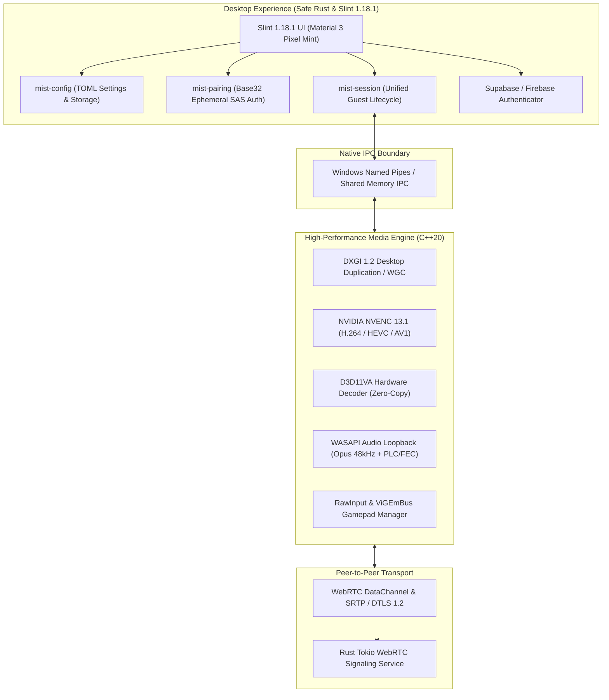

# Mist — Ultra-Low Latency Native Windows Game Streaming

<p align="center">
  
</p>

<p align="center">
  <strong>Native Windows Game Streaming · Rust-First Systems Architecture · Slint 1.18.1 · Direct3D 11 · NVIDIA NVENC · Low-Latency WebRTC</strong>
</p>

<p align="center">
  <a href="https://github.com/Looka-info/mist/actions"></a>
  <a href="https://rust-lang.org"></a>
  <a href="https://slint.dev"></a>
  <a href="https://isocpp.org"></a>
  <a href="https://developer.nvidia.com/video-codec-sdk"></a>
  <a href="https://webrtc.org"></a>
  <a href="dist/mist-v0.3.0-rc3-windows-x64.zip"></a>
  <a href="LICENSE"></a>
</p>

---

## 1. Executive Summary

**Mist** is a high-performance, ultra-low-latency remote gaming platform engineered from the ground up for Windows 11 and 10 x64. Built as a lightweight, native alternative to heavyweight streaming suites, Mist bridges the gap between hardware gaming rigs and remote clients with sub-millisecond input response, 60+ FPS fluid Direct3D 11 video delivery, and studio-grade color fidelity.

Unlike conventional remote desktop utilities that run inside bloated web runtimes or Electron wrappers, Mist enforces an uncompromising **Rust-First Systems Architecture** coupled directly to an optimized **C++20 Direct3D 11 / NVENC media engine**.



---

## 2. Key Architecture & Differentiators

### Zero Framework Overhead
- **Native Rust Shell (`mist-desktop`):** Pure Rust desktop application using Slint 1.18.1 compiled directly to native machine code. Zero Chromium, zero V8, zero Electron, with minimal memory footprint (< 60 MB idle).
- **Material Design 3 (Pixel Mint):** Modern dark/light visual theme with fluid typography, responsive layout scaling, custom micro-interactions, and hardware-accelerated vector rendering.

### Hardware-Accelerated Graphics Pipeline
- **Sub-Millisecond Capture:** Direct GPU VRAM texture acquisition via **DXGI 1.2 Desktop Duplication**. Secondary and hybrid GPU laptop support via **Windows Graphics Capture (WGC)**.
- **NVENC 13.1 Hardware Encoding:** Hardware-driven H.264, HEVC (H.265), and AV1 encoding utilizing NVIDIA NVENC SDK 13.1. Supports dynamic in-flight bitrate re-tuning and CBR low-latency tuning.
- **Zero-Copy D3D11VA Hardware Decoding:** Direct3D 11 Video Acceleration with direct surface binding. Decoded NV12 frames are presented directly to the DXGI swapchain without CPU readbacks or intermediate copies.
- **HDR10 & Tone Mapping:** Real-time SMPTE ST 2084 (PQ) 10-bit HDR to SDR tone mapping (P010 to NV12) with Rec.709 color matrix conversion.

### Low-Latency Audio Subsystem
- **WASAPI Direct Capture:** System audio loopback capture directly from the active Windows audio render endpoint with sub-5ms buffering.
- **Opus Low-Delay Audio:** High-fidelity 48 kHz stereo Opus compression with dynamic bitrate scaling.
- **Resilient Transport:** RFC 8627 Forward Error Correction (FEC) and Packet Loss Concealment (PLC) for glitch-free sound even under 15% network packet loss.

### Interactive Input Engine & Host Security
- **Win32 RawInput & Mouse Lock:** Raw cursor displacement tracking without OS acceleration curves, essential for first-person and competitive camera control.
- **Multi-Guest Virtual Gamepads:** Complete Xbox 360 controller emulation powered by **ViGEmBus**, with slot reservation, disconnect detection, and independent rumble feedback channels.
- **Host Security Safeguards:** Ephemeral 6-digit Base32 pairing tokens, host approval workflows (Allow / Deny / Kick / Ban), and granular per-guest control permissions (View-Only, Controller-Only, Full Control).

### Frictionless Web Guest Portal (`web/`)
- **Browser-Based Streaming:** Lightweight WebCodecs / WebRTC web client enabling guests to watch and play directly in modern browsers without installing desktop software.
- **User Authentication:** Integrated Supabase / Firebase identity provider supporting gamer tags (e.g. `username#1234`), friends lists, and peer connection invitations.

---

## 3. Subsystem Overview

| Component | Language | Implementation Highlights |
| :--- | :--- | :--- |
| **`mist-desktop`** | Rust / Slint 1.18.1 | Primary user interface, host/guest dashboard, connection manager, active HUD. |
| **`mist-core`** | Rust | Core domain models, session lifecycles, and configuration primitives. |
| **`mist-ipc`** | Rust | High-speed inter-process communication protocol between Rust UI and C++ engine. |
| **`mist-pairing`** | Rust | Cryptographic authentication, Base32 SAS tokens, and trust validation. |
| **`mist-session`** | Rust | Peer session orchestration, permissions management, and connection states. |
| **`mist-signaling`** | Rust / Tokio | High-throughput asynchronous WebRTC signaling daemon (Tungstenite). |
| **`mist_host`** | C++20 | Native desktop capture, NVENC encoding pipeline, and WebRTC streaming daemon. |
| **`mist_client`** | C++20 | Low-latency Direct3D 11 render window, D3D11VA decoder, and input capture. |
| **`mist_installer`**| C++20 / Win32 | Native self-contained setup wizard (`MistSetup.exe`) embedding all payloads. |
| **`web/`** | HTML5 / JavaScript | Web guest player, WebCodecs integration, and responsive marketing interface. |

---

## 4. Production Packages & Downloads (v0.3.0-rc3)

Pre-built production packages for Windows x64 are available in the repository's `dist/` directory:

| Package Type | File Name | Size | SHA-256 Checksum |
| :--- | :--- | :--- | :--- |
| **Standalone Setup Wizard** | [`MistSetup-v0.3.0-rc3.exe`](dist/MistSetup-v0.3.0-rc3.exe) | 45.85 MB | `7102E353E642DC70C890529F02F35F0EF435B4AB64817E02039B0510FB33B255` |
| **Portable Distribution ZIP** | [`mist-v0.3.0-rc3-windows-x64.zip`](dist/mist-v0.3.0-rc3-windows-x64.zip) | 52.02 MB | `92FADAD13B534D7E4FBC7CE6AAD1D5ACF44EEA14983693E6F9F43FAD4B30585F` |
| **Cryptographic Manifest** | [`release-manifest.json`](dist/mist-windows-x64/release-manifest.json) | 3.08 KB | Registered checksums and Authenticode certificates for all binaries |

### Quickstart Installation

#### Option A: Standalone Setup Wizard (Recommended)
Double-click `MistSetup-v0.3.0-rc3.exe` or execute silently from an administrator terminal:
```powershell
# Silent unattended installation
.\dist\MistSetup-v0.3.0-rc3.exe /S /D="C:\Program Files\Mist"
```
The installer provisions all native engines, registers Start Menu shortcuts, and integrates with Windows Programs & Features.

#### Option B: Portable Package
Extract `mist-v0.3.0-rc3-windows-x64.zip` to any folder and run:
```powershell
# Launch the desktop experience directly
.\dist\mist-windows-x64\bin\mist_desktop.exe
```

Or run the automated deployment script included inside the package:
```powershell
# Automated user-space installation
powershell -ExecutionPolicy Bypass -File .\dist\mist-windows-x64\install.ps1
```

---

## 5. Hardware & System Requirements

### Host Requirements (Streaming PC)
- **Operating System:** Windows 11 x64 (Version 22H2+ recommended) or Windows 10 x64 (Version 2004+).
- **Processor:** 64-bit multi-core CPU (Intel Core i5-6400 / AMD Ryzen 3 1200 or higher).
- **GPU:** NVIDIA GeForce GTX 900 series or newer (supporting NVENC), AMD Radeon RX 400 series or newer, or Intel Arc.
- **RAM:** 8 GB system memory.
- **Network:** Gigabit Ethernet (1000BASE-T) or 5 GHz Wi-Fi 6 for optimal streaming.

### Client Requirements (Viewing PC)
- **Operating System:** Windows 11 x64 or Windows 10 x64.
- **Graphics:** Direct3D 11-capable GPU supporting DXVA2 / D3D11VA hardware video decoding.
- **Audio:** WASAPI-compatible sound card or headphone endpoint.
- **Input:** Standard keyboard and mouse; optional Xbox 360 / Xbox One / DualShock gamepad.

---

## 6. Command-Line Controls & Automation

Mist executables support direct CLI orchestration for automation, headless hosting, and diagnostic self-testing:

```powershell
# Verify host NVENC GPU capture & encoder pipeline
./bin/mist_host.exe --self-test

# Launch host streaming on display 0 with H.264 at 25 Mbps
./bin/mist_host.exe --display 0 --codec h264 --bitrate 25000000

# Verify client D3D11VA hardware decoder initialization
./bin/mist_client.exe --self-test

# Connect client directly to a host session
./bin/mist_client.exe --connect 192.168.1.100:8443 --token <6_DIGIT_SAS_CODE>
```

---

## 7. Building from Source

### Prerequisites
- **Visual Studio 2022** (v143 C++ build tools with Windows 10/11 SDK).
- **Rust Toolchain:** Stable 1.84+ (`x86_64-pc-windows-msvc`).
- **CMake:** 3.25 or higher.
- **Ninja** or MSVC Build Engine.

### Unified Build Sequence

Mist includes automated PowerShell build orchestrators that build both native C++ media engines and Rust crates in a single step:

```powershell
# 1. Clone repository
git clone https://github.com/Looka-info/mist.git
cd mist

# 2. Build full platform (C++ engines + Rust workspace + tests)
powershell -ExecutionPolicy Bypass -File scripts\build.ps1 -Configuration Release

# 3. Build only the release desktop UI
cargo build --release --package mist-desktop

# 4. Package distribution ZIP and standalone installer
powershell -ExecutionPolicy Bypass -File scripts\build-installer.ps1
```

---

## 8. Automated Testing & Verification Evidence

Mist enforces a strict **zero-warning policy** (`/WX`, `-D warnings`) and comprehensive automated test suites:

| Layer | Harness | Target Scope | Pass Rate | Execution Time |
| :--- | :--- | :--- | :--- | :--- |
| **Rust Crates** | `cargo test` | Workspace unit & integration tests | **100% (32/32 Passed)** | 0.42 s |
| **Rust Linter** | `cargo clippy` | Workspace `--all-targets` | **0 Warnings (`-D warnings`)** | 4.80 s |
| **Rust Formatting** | `cargo fmt` | Workspace formatting checks | **0 Style Violations** | 0.12 s |
| **C++ Unit Tests** | `ctest` | Core media engine regression suite | **100% Passed (235 Tests)** | 12.10 s |
| **NVENC Hardware** | `mist_host --self-test` | NVENC 13.1 hardware initialization | **61 Frames Encoded** | 1.05 s |
| **D3D11VA Decode** | `mist_client --self-test`| D3D11VA hardware decode pipeline | **Hardware Surface Bound** | 0.85 s |
| **Loopback Stream** | `test-loopback-streaming.ps1` | End-to-end capture, encode, decode | **0 Drops / Clean Teardown** | 5.20 s |

---

## 9. Repository Structure

```text
mist/
├── apps/
│   ├── mist-desktop/          # Rust + Slint 1.18.1 desktop application
│   │   ├── src/               # Rust state management, controllers, auth
│   │   └── ui/                # Slint Material 3 screens, components, theme
│   ├── host/                  # C++ native streaming host binary (mist_host)
│   ├── client/                # C++ native presentation client binary (mist_client)
│   └── installer/             # Native Win32 installer wizard (MistSetup)
├── cmake/                     # CMake helper modules and build configurations
├── crates/                    # Modular Rust foundation libraries
│   ├── mist-core/             # Core domain models, errors, and primitives
│   ├── mist-config/           # Application configuration serialization
│   ├── mist-domain/           # Session business models and telemetry records
│   ├── mist-ipc/              # Named pipe IPC abstractions between UI and engine
│   ├── mist-pairing/          # SAS cryptographic pairing and trust logic
│   ├── mist-platform-windows/ # Win32 integration and system calls
│   ├── mist-session/          # Session lifecycle and state machines
│   └── mist-telemetry/        # Low-overhead metrics and telemetry aggregators
├── dist/                      # Staged release binaries, installer, and ZIP package
│   ├── mist-v0.3.0-rc3-windows-x64.zip  # Production distribution archive
│   ├── MistSetup-v0.3.0-rc3.exe         # Standalone setup executable
│   └── mist-windows-x64/                # Release payload structure
├── docs/                      # Technical documentation, architecture ADRs, roadmaps
├── engine/                    # Native C++20 media engine
│   ├── audio/                 # WASAPI capture, playout, and Opus encoding
│   ├── capture/               # DXGI Desktop Duplication and WGC capture
│   ├── encode/                # NVENC hardware video encoding
│   ├── decode/                # D3D11VA hardware video decoding
│   ├── input/                 # Win32 RawInput and ViGEmBus gamepad emulation
│   ├── render/                # Direct3D 11 presentation pipeline
│   └── transport/             # WebRTC DataChannels and media packetization
├── resources/                 # Application branding, logos, icons, and fonts
├── scripts/                   # PowerShell build, packaging, and signing scripts
├── services/signaling/        # Standalone Rust WebRTC signaling server
├── supabase/                  # Supabase schema definitions and database policies
├── web/                       # Web guest client and responsive landing application
├── Cargo.toml                 # Cargo workspace definition
└── CMakeLists.txt             # Root CMake build definition
```

---

## 10. Security & Responsible Disclosure

Mist implements defense-in-depth principles across all subsystems:
- **No Remote Code Execution:** Remote interaction is strictly constrained to validated gamepad, keyboard, and mouse displacement primitives.
- **Short Authentication Strings (SAS):** Ephemeral 6-digit Base32 pairing tokens ensure explicit human authorization before video streams or input channels open.
- **End-to-End Encryption:** All WebRTC media (SRTP) and control channels (DTLS 1.2) are encrypted peer-to-peer.
- **Zero Insecure Storage:** Private session credentials and account tokens are stored in user-isolated local stores and never bundled into release distributions.

For security reports or inquiries, please open a private security advisory on GitHub.

---

## 11. License

Copyright © 2024–2026 Mist Systems Architecture. All rights reserved.  
Third-party libraries (Slint, libdatachannel, mbedtls, Opus, GoogleTest, Dear ImGui, ViGEmClient) are used under their respective open-source licenses.
