# Mist Cross-Platform Test & Qualification Matrix

**Document Version:** 1.0.0  
**Target Milestone:** Milestone 28 (Release Qualification)  
**Baseline Git Tag:** `v0.3.0-rc2` (Preserved intact)  
**Active Working Branch:** `feature/milestone-28-release-qualification`

---

## 1. Executive Summary

This qualification matrix defines the platform targets, architectural subsystems, qualification levels, and test coverage for Mist v0.3.0.

In strict adherence to project standards, qualification states distinguish clearly between code that compiles, code tested in synthetic or headless CI environments, and code verified on physical GPU hardware.

---

## 2. Qualification Level Definitions

| Level | Qualification Stage | Criteria |
|:---|:---|:---|
| **L0** | **Specified** | Architecture, wire protocol, and memory layouts documented in repository specifications. |
| **L1** | **Implemented** | Complete native source code present without synthetic mocks, empty stubs, or random simulations. |
| **L2** | **Built & Linked** | Compiles cleanly with `-Wall -Wextra -Werror` / `/WX` across designated toolchains. |
| **L3** | **Unit Tested** | Headless unit tests and behavioral contracts pass (e.g. CTest, `cargo test`, Node assertions). |
| **L4** | **Integration Tested** | End-to-end protocol exchanges, loopback signaling, and DataChannel packet validation pass. |
| **L5** | **Hardware Verified** | Executed and validated on real physical GPU hardware, displays, and audio controllers. |

---

## 3. Platform Qualification Matrix

| Platform Target | Video Decoder Engine | Audio Engine | Input Pipeline | Current Qualification Level | Evidence / Status |
|:---|:---|:---|:---|:---:|:---|
| **Windows 11 / x64** | Direct3D 11 Video Acceleration (D3D11VA) | WASAPI (Loopback & Playback) | Windows Raw Input / SendInput | **L5: Hardware Verified** | Passed on Windows 11 host (D3D11 swapchain, NVENC capture, 235 CTest tests, Slint UI). |
| **macOS (Apple Silicon & Intel)** | VideoToolbox (`VTDecompressionSession`) | CoreAudio (`AudioUnit`) | CoreGraphics Input Synthesizer | **L3: Unit Tested** (CI Built) | VideoToolbox lifecycle, atomic shutdown guard, and dynamic SPS/PPS reconfiguration unit tested. |
| **Linux (Ubuntu 24.04 x64)** | VA-API / DRM DMA-BUF (`vaCreateSurfaces`) | PulseAudio / ALSA | X11 / uinput | **L3: Unit Tested** (CI Built) | VA-API parameter buffer packing, picture descriptors, and DMA-BUF export lifecycle unit tested. |
| **Android (API 29+ ARM64)** | NDK `AMediaCodec` (`AMediaFormat`) | AAudio / OpenSL ES | Android NDK Input / MotionEvent | **L3: Unit Tested** (CI Built) | Output buffer index 0 ownership, format change dimension updates, and `ANativeWindow` window target verified. |
| **Web Browser (Chromium / WebKit / Gecko)** | WebCodecs `VideoDecoder` / WebRTC Track | Web Audio API / HTMLAudioElement | Pointer Lock & SCTP DataChannel | **L4: Integration Tested** | Signaling offer/answer exchange, ICE candidate queueing, and 48-byte native binary input packet packing verified. |

---

## 4. Subsystem Verification Breakdown

### 4.1 Native Video Decoders (`engine/decode`)
- **Windows D3D11VA:** Initialized via Direct3D 11 device contexts. Supports H.264 High Profile and HEVC Main Profile. Verified zero-copy rendering to swapchain.
- **macOS VideoToolbox:** Uses `CMVideoFormatDescriptionCreateFromH264ParameterSets` with non-blocking callback queuing. Concurrency deadlock resolved by releasing `mutex_` prior to `VTDecompressionSessionWaitForAsynchronousFrames`.
- **Linux VA-API:** Ring buffer manages `VASurfaceID` resources with picture parameter buffer, IQ matrix, and slice data buffer packing. Resource exhaustion correctly handles bounded recycling and DMA-BUF file descriptor export.
- **Android MediaCodec:** Configured via NDK `AMediaCodec_createDecoderByType`. Releases buffer index 0 safely with `render = true/false` targeting `ANativeWindow`.
- **WebCodecs Browser:** Probes client browser codecs via `VideoDecoder.isConfigSupported()`. Falls back cleanly to `RTCPeerConnection.ontrack` with zero synthetic framerate loops.

### 4.2 WebRTC Signaling & Transport
- **Signaling Protocol:** Asynchronous WebSocket server (`services/signaling`) utilizing `tokio-tungstenite` and `serde_json` with snake_case message framing.
- **Race Condition Guard:** Browser client queues incoming `candidate` messages received prior to `pc.setRemoteDescription()`, preventing `InvalidStateError` and candidate drops.
- **Input SCTP DataChannel:** Uses channel label `"mist-input"`. Packs 48-byte `InputPacketHeader` followed by exact C++ payload structs (`MouseMovePayload`, `MouseButtonPayload`, `KeyPayload`, `MouseWheelPayload`).

---

## 5. Automated CI Verification Matrix

The CI workflow `.github/workflows/ci.yml` enforces the cross-platform qualification gates:

```mermaid
flowchart TD
    A["Push / Pull Request"] --> B["windows-x64 (Windows 2022)"]
    A --> C["macos (macOS 14 ARM64)"]
    A --> D["linux-x64 (Ubuntu 24.04)"]
    A --> E["android-ndk (Ubuntu 24.04 + NDK r26b)"]
    A --> F["web-wasm (Ubuntu 24.04 + Node 20)"]

    B --> B1["Cargo Test Workspace"]
    B --> B2["CMake MSVC C++20 Build"]
    B --> B3["235 CTest Regression Tests"]
    B --> B4["Host & Client Self-Tests"]
    B --> B5["Installer Package Build"]

    C --> C1["Cargo Test Core/Crypto"]
    C --> C2["CMake mist_decode Build"]
    C --> C3["Clang++ VideoToolbox Linkage"]

    D --> D1["Cargo Test Core/Crypto"]
    D --> D2["CMake mist_decode Build"]
    D --> D3["G++ VA-API Linkage"]

    E --> E1["NDK r26b aarch64 Clang++"]
    E --> E2["AMediaCodec Target Build"]

    F --> F1["Syntax & Protocol Validation"]
    F --> F2["WebRTC Integration Test Suite"]
```

---

## 6. Known Limitations & Target Hardware Next Steps

1. **Physical Apple Silicon Testing:** VideoToolbox pipeline compiles cleanly and passes unit tests, but real Metal layer display presentation requires a physical Mac workstation.
2. **Physical Linux GPU Acceleration:** VA-API integration requires physical Intel QuickSync or AMD Radeon GPU device `/dev/dri/renderD128` to execute hardware decoding; headless VMs fall back to graceful unsupported return.
3. **Physical Android Devices:** NDK binary targets ARM64-v8a; presentation requires an active Android `SurfaceView` or `TextureView` on physical hardware.
